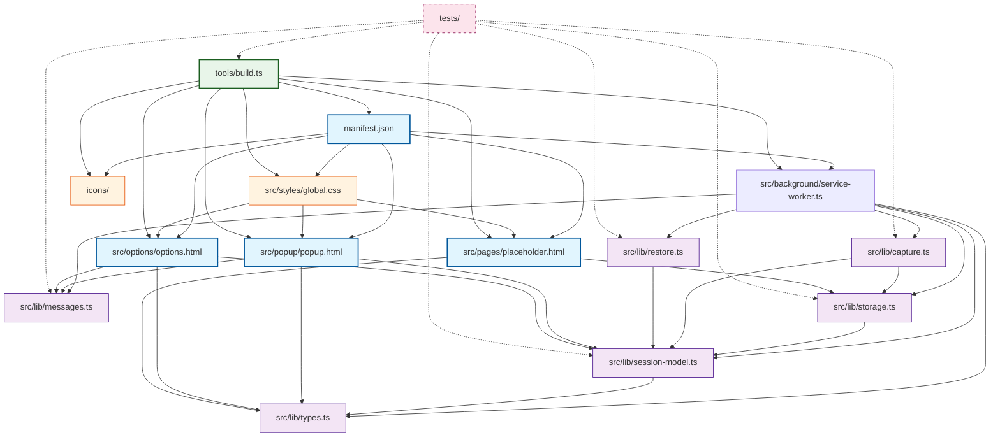
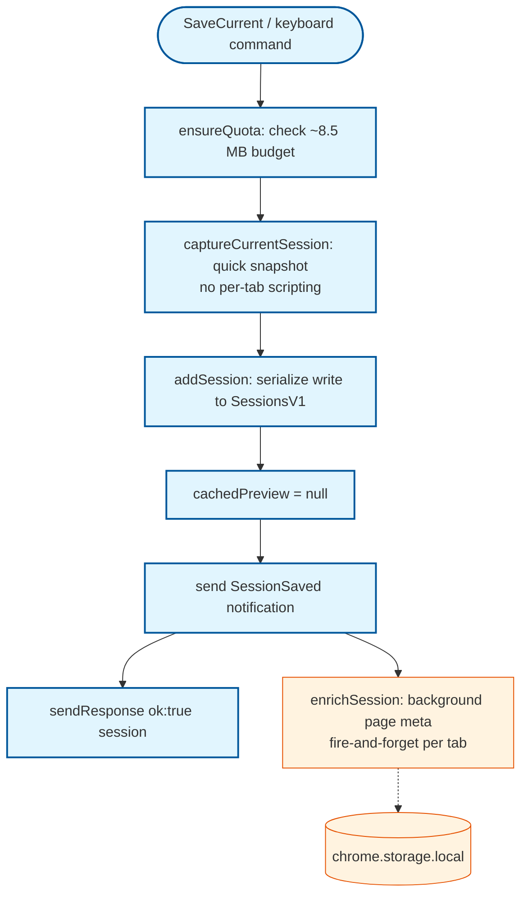
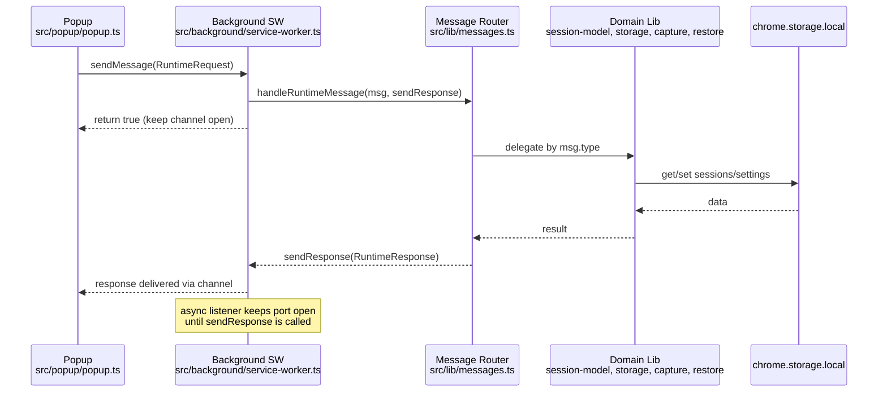
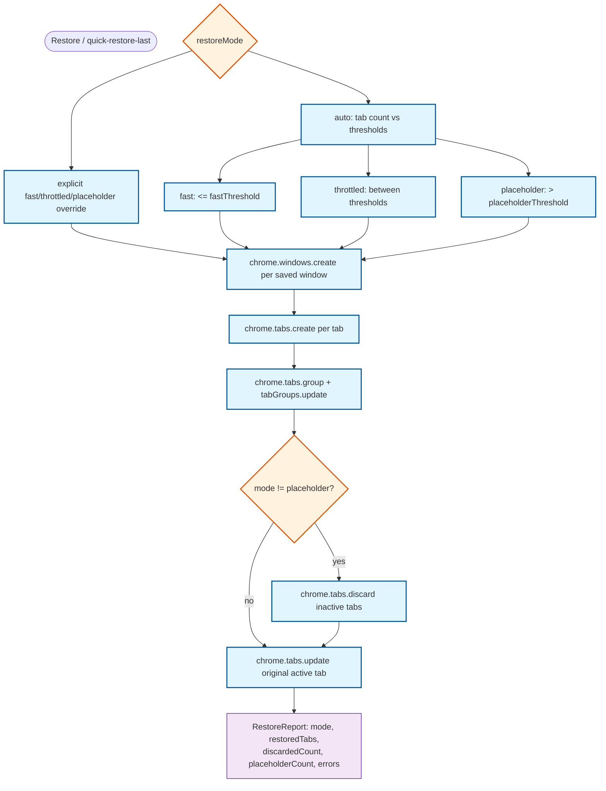
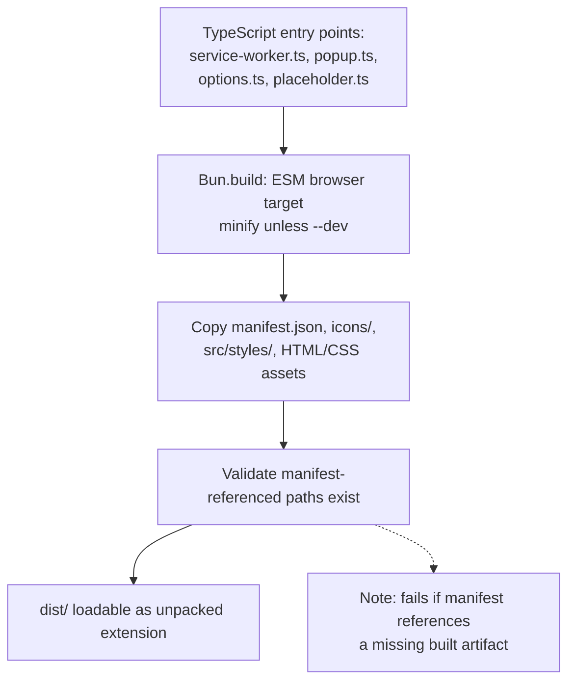

# Edge Sessions

Save and restore browser sessions: all windows, tabs, and tab group names, colors, and order. Adaptive lazy restore prevents out-of-memory (OOM) failures on large sessions.

Manifest V3 extension for Chrome / Edge. Minimum browser version 116. The extension is authored in TypeScript and built with Bun. Load `dist/` as an unpacked extension after running the build.

## Build and development

```bash
bun install
bun run typecheck       # TypeScript check (src + tools)
bun run build:dev       # Development build to dist/
```

Load `dist/` from `edge://extensions` as an unpacked extension.

```bash
bun run check           # typecheck, tests, production build, artifact tests
```

## File layout

```
manifest.json           # MV3 manifest: permissions, background service worker,
                        # action popup, options page, commands
icons/
  edge-sessions-128.png
  edge-sessions-512.png
  edge-sessions.svg
src/
  styles/global.css     # Shared design system (tokens, buttons, inputs, cards,
                        # focus) loaded first by every HTML page
  background/
    service-worker.ts   # MV3 service worker: message router, keyboard commands,
                        # autosave alarm, install/update handlers
  lib/
    types.ts            # TypeScript interfaces: Session, SavedTab, SavedWindow,
                        # SavedGroup, Settings, RestoreReport, message types
    session-model.ts    # SchemaVersion, StorageKeys, RestoreModes,
                        # SettingLimits, DefaultSettings, normalizeSettings,
                        # validateSettingsPatch, validateSession,
                        # isRestorableUrl, sanitizeGroupColor,
                        # getDomainFromUrl, createTabKey, createSessionId
    storage.ts          # chrome.storage.local wrappers: sessions, settings,
                        # autosave, serializedWrite mutation queue
    capture.ts          # captureCurrentSession (quick snapshot), extractPageMeta,
                        # executeScriptWithTimeout, enrichSession
    restore.ts          # restoreSession (fast / throttled / placeholder modes),
                        # buildPlaceholderUrl
    messages.ts         # RuntimeRequest, RuntimeNotification, RuntimeResponse
                        # discriminated unions for popup <-> background
  popup/
    popup.html          # Extension action popup
    popup.ts            # Session list, save, restore, delete, rename, search,
                        # filter, detail treeview
    popup.css           # Page-specific overrides
  options/
    options.html        # Settings page
    options.ts          # Settings read/write, session import/export, threshold
                        # validation
    options.css         # Page-specific overrides
  pages/
    placeholder.html    # Lazy placeholder page shown instead of loading a tab
    placeholder.ts      # Loads saved meta from storage by sessionId + tabKey,
                        # renders URL/domain/description/favicon/OG image/theme
    placeholder.css     # Page-specific overrides
tests/
  session-model.test.ts # Schema, settings normalization, validators, URL helpers
  storage.test.ts       # SessionsV1 pruning, source isolation, quota, settings
  restore.test.ts       # Placeholder URL, restore mode selection, skip behavior
  messages.test.ts      # Message router: save/get/delete/rename/export/import
  capture.test.ts       # captureCurrentSession and enrichSession
  mocks/chrome.ts       # Mock chrome.* runtime used by tests
  build-artifact.test.ts# Post-build contract: manifest references, HTML assets,
                        # JS entry points, no .ts leaks, no sourcemaps
tools/build.ts          # Build pipeline: TypeScript entry points + static assets;
                        # validates manifest-referenced files exist
README.md
```

## Architecture overview



## Storage schema

- `SessionsV1`: array of `Session` objects. Each session carries a `source` ("user" or "auto") so user-saved and autosaved sessions share one list but are pruned independently.
- `SettingsV1`: settings object merged over `DefaultSettings` and normalized on read.
- `AutosaveSnapshotV1`: last autosaved session (isolated from `SessionsV1`)

Sessions are stamped with `SchemaVersion` (currently `2`). `getSessions()` drops any record whose `version` does not match, so a future schema migration can be added without crashing on stale data. Legacy sessions without `source` default to "user" on read.

## Save flow

Saving is split into two phases:

1. **Quick snapshot** — capture all windows, tabs, and group metadata with no per-tab page scripting. The session is written to storage immediately, so the save ends fast and the popup list reflects it right away.
2. **Background enrichment** — best-effort page meta (OG title, description, image, theme color, H1) is fetched per tab via `chrome.scripting.executeScript` with a hard per-tab timeout. Enrichment is fire-and-forget; tabs that block scripting (CSP, `edge://`, `chrome://`, PDF, closed tabs) are silently skipped, and the save remains durable without them.



## Limitations

- Bun is a build-time dependency only; the packaged extension contains browser-standard JavaScript and does not require Bun or Node at runtime.
- The background service worker is an ES module (`"type": "module"`), so it runs in strict mode. Popup, options, and
  placeholder pages are classic scripts and run in sloppy mode unless they opt in.
- Meta extraction requires page scripting permission and a loaded tab; discarded, sleeping, or script-blocked tabs store empty meta, so the placeholder may show no description or favicon.
- Internal browser pages (`edge://`, `chrome://`, `chrome-extension://`, `chrome-search://`, `about:`, `view-source:`, `data:`, `javascript:`) are preserved in the snapshot but skipped during restore.
- `chrome.storage.local` is subject to quota; `ensureQuota` trims old sessions automatically when storage exceeds ~8.5 MB.
- `web_accessible_resources` is not declared. Extension pages load their own assets relative to themselves, so no cross-site exposure is needed.
- Host permission `<all_urls>` is required because `chrome.scripting.executeScript` runs on arbitrary tabs and restore navigates to arbitrary URLs.

## Loading the extension

1. Run `bun install` then `bun run build:dev` (or `bun run check` for production).
2. Open `edge://extensions` (or `chrome://extensions`).
3. Enable Developer mode.
4. Click Load unpacked and select the `dist/` directory.
5. Pin the extension action to the toolbar if desired.

## Manifest

MV3. Permissions: `tabs`, `tabGroups`, `windows`, `storage`, `alarms`, `scripting`. Host permission: `<all_urls>`. Background is a module service worker at `src/background/service-worker.ts`. The extension action opens `src/popup/popup.html`. Options are provided via `options_ui` (`src/options/options.html`, `open_in_tab: true`). `quick-save` (Ctrl+Shift+S / Command+Shift+S) and `quick-restore-last` (Ctrl+Shift+R / Command+Shift+R) are registered keyboard commands.

## Background service worker (`src/background/service-worker.ts`)

MV3 service worker (ES module). Installs default settings and an empty session list on install, creates the autosave alarm, and registers `chrome.commands.onCommand` and `chrome.alarms.onAlarm` (autosave). Exposes a message API to popup and options via `handleRuntimeMessage` (defined in `src/lib/messages.ts`):

- `SaveCurrent` — captures and persists the current session
- `GetSessions` — returns sessions and settings
- `Restore` — restores a session by id via `src/lib/restore.ts`
- `Delete`, `Rename`, `Export`, `Import`, `GetSettings`, `UpdateSettings`
- `CapturePreview` — returns a cached capture of the current session (re-captured only after a save)

The `chrome.runtime.onMessage` listener returns `true` to keep the async response channel open.

### Runtime message flow



### Concurrency and data safety

All storage read-modify-write mutations (`addSession`, `deleteSession`, `renameSession`, `ensureQuota`) are serialized through an in-memory mutex so concurrent saves (keyboard command + manual save, or autosave + manual save) cannot interleave and overwrite each other — `chrome.storage.local` has no transactions.

`quick-restore-last` prefers the most recent auto-saved session (`source === "auto"` in `SessionsV1`) and falls back to the most recent user-saved session (`SessionsV1[0]`) only when no autosave exists. Autosave writes share the same session list as manual saves but are pruned independently via `maxAutoSessions`.

`Import` validates every imported session with `validateSession()`, rejects records that fail, caps the payload at 2 MB, and reports how many sessions were accepted vs. rejected. Invalid records are never persisted.

`UpdateSettings` validates and normalizes settings via `normalizeSettings()` and `validateSettingsPatch()` in `src/lib/session-model.ts` before writing. Thresholds are cross-checked so `fastThreshold` must remain below `placeholderThreshold`.

## Architecture modules

### `src/lib/messages.ts`

Defines the discriminated unions for the popup <-> background contract:

- `RuntimeRequest`: `SaveCurrent`, `GetSessions`, `Restore`, `Delete`, `Rename`, `Export`, `Import`, `GetSettings`, `UpdateSettings`, `CapturePreview`
- `RuntimeNotification`: `SessionSaved`, `SessionEnriched`, `RestoreProgress`, `SaveFailed`
- `RuntimeResponse`: shaped reply with `ok`, `error`, `session`, `sessions`, `settings`, `report`, `data`, `count`, `rejected`

### `src/lib/session-model.ts`

Defines `SchemaVersion` (currently `2`), `StorageKeys` (`SessionsV1`, `SettingsV1`, `AutosaveSnapshotV1`), `RestoreModes` (`auto`, `fast`, `throttled`, `placeholder`), `SettingLimits`, `DefaultSettings`, and TypeScript interfaces for `SavedTab`, `SavedWindow`, `SavedGroup`, and `Session`. Provides `createSessionId`, `validateSession`, `isRestorableUrl`, `sanitizeGroupColor`, `getDomainFromUrl`, `createTabKey`, `normalizeSettings()`, and `validateSettingsPatch()`.

`DefaultSettings` includes `restoreInNewWindow` (default `true`), `skipInternalPages`, `restorePinnedFirst`, `restoreMode` (default `"auto"`), `autoDiscardEnabled`, `placeholderThreshold` (250), `fastThreshold` (80), `batchSize` (20), `batchPauseMs` (50), `placeholderAutoLoad`, `maxUserSessions` (50), and `maxAutoSessions` (30).

`normalizeSettings()` repairs legacy/out-of-range persisted values (removing obsolete `maxSessions` and `adaptiveRestoreEnabled`), clamps every numeric setting to its canonical limit, and repairs `fastThreshold < placeholderThreshold`. `validateSettingsPatch()` cross-checks thresholds before a settings write is accepted.

Internal URLs (`edge://`, `chrome://`, `chrome-extension://`, `chrome-search://`, `about:`, `view-source:`, `data:`, `javascript:`) are not restorable and are skipped during restore.

### `src/lib/storage.ts`

Wrappers around `chrome.storage.local.get`/`set` for sessions, settings, quota, and autosave. All read-modify-write mutations are serialized through `serializedWrite` (an in-memory queue) so concurrent saves cannot interleave and overwrite each other — `chrome.storage.local` has no transactions. `getSettings()` returns normalized settings via `normalizeSettings()`. `updateSettings()` validates and normalizes patches via `validateSettingsPatch()` before writing. `addSession()` prunes user-saved and auto-saved sessions independently via `maxUserSessions` and `maxAutoSessions`. `ensureQuota` trims the session list to 10 entries when storage exceeds 8.5 MB. `getAutosave()` reads the isolated `AutosaveSnapshotV1` key.

### `src/lib/capture.ts`

`captureCurrentSession(name, source, skipMeta)` enumerates all normal windows via `chrome.windows.getAll({ populate: true })`, queries tab groups, and builds `SavedWindow[]` with `SavedTab[]` per window. By default (`skipMeta = true`) it performs a quick snapshot with no per-tab page scripting so the save ends fast. Each saved tab persists its live `tabId` (not part of the restore contract) for later enrichment. For each http(s) tab it runs `extractPageMeta` through `chrome.scripting.executeScript` in the page context to capture `description`, `ogTitle`, `ogDescription`, `ogImage`, `themeColor`, `h1`, and `domain`. Meta extraction fails silently for discarded/sleeping tabs or sites that block scripting; those tabs store empty meta. Each tab receives a stable `tabKey` (`sessId-w{index}-t{index}`) used by the placeholder page for lookup.

`enrichSession(sessionId)` runs best-effort background enrichment after a save: it fetches page meta per tab via `chrome.scripting.executeScript` with a hard per-tab timeout (`executeScriptWithTimeout`), skips tabs without a valid `tabId` (legacy sessions), skips tabs that already have meta, and persists only changed sessions back to storage. Enrichment is fire-and-forget — script-blocked or unresponsive tabs are skipped without affecting the already-durable save.

### `src/lib/restore.ts`

`restoreSession(session, settings, onProgress)` supports an explicit `restoreMode` plus automatic threshold-based selection:

- `restoreMode: "auto"` (default) — chooses a mode from total tab count and thresholds (`placeholderThreshold`, `fastThreshold`):
  - `fast` (<= `fastThreshold`): immediate restore, short delay between tabs
  - `throttled` (between thresholds): delayed tab creation with batching and `yieldToUI`
  - `placeholder` (> `placeholderThreshold`): every tab opens `src/pages/placeholder.html?sessionId=&tabKey=&url=&title=` instead of the real URL, preventing OOM; the real page loads only when the user activates the placeholder tab
- `restoreMode: "fast"` — always fast
- `restoreMode: "throttled"` — always throttled
- `restoreMode: "placeholder"` — always placeholder

In placeholder mode, windows are created with placeholder URLs, groups are re-created after tabs exist, and tabs are never discarded. In normal/throttled modes, inactive tabs are discarded via `chrome.tabs.discard` after creation to bound memory. The original active tab is re-activated at the end (matched by `tabKey` in placeholder mode).

When `restoreInNewWindow` is `false`, the first saved window restores into the current active window instead of spawning a new one; later windows still spawn new. `fullscreen`, `maximized`, and `minimized` window states are all restored.

Returns a report with `mode`, `restoredTabs`, `createdWindows`, `discardedCount`, `placeholderCount`, `skippedTabs`, and `errors`.

## Restore flow



## Popup (`src/popup/`)

`popup.html` lists saved sessions in cards. Each card shows name, timestamp, window/tab/group counts, group pills, a large-session warning when `tabCount > 250`, and action buttons: Restore, Rename, Delete. The Restore button requires confirmation before sending the `Restore` message. A progress bar shows live restore progress via `chrome.runtime.onMessage` (`RestoreProgress`). The popup provides Save Entire Session and an Open Settings action in its header. Session search matches session names as well as tab titles, URLs, and domains. `liveStats` shows a capture preview of the current session. Import and Export are available only on the Options page.

The session-name input has an associated `<label>`, icon buttons use `aria-label`, and all buttons show a visible `:focus-visible` outline (WCAG 2.2 AA).

## Options (`src/options/`)

Settings page for `autosaveEnabled`, `autosaveIntervalMinutes`, `restorePinnedFirst`, `skipInternalPages`, `restoreMode`, `autoDiscardEnabled`, `placeholderThreshold`, `fastThreshold`, `maxUserSessions`, and `maxAutoSessions`. Restore processing can be automatic or explicitly forced to fast, throttled, or placeholder mode. Settings are normalized and validated against canonical ranges in `src/lib/session-model.ts`; the fast threshold must remain below the placeholder threshold. The page also supports exporting and importing saved sessions.

## Placeholder page (`src/pages/`)

Loaded when a tab is restored in placeholder mode. Reads `sessionId` and `tabKey` from the query string, looks the tab up in `chrome.storage.local.get("SessionsV1")`, and renders the saved title, URL, domain, description (`ogDescription` > `description` > `h1`), saved favicon (with Google favicon service fallback keyed off domain), OG image, theme color accent, and saved timestamp. Buttons: Load This Page (navigates to the real URL), Open in New Tab, Copy URL. Falls back to URL-query title/URL if storage lookup fails.

## Styling

`src/styles/global.css` is the shared design system loaded first by every HTML page. It defines semantic tokens for colors, typography, borders, radii, and shadows; base body styles; shared `.app-header`, `.app-logo`, `.surface-card`, `.btn` variants, and `.form-control` controls; and a high-contrast `:focus-visible` treatment (WCAG 2.2 SC 2.4.11). Each page stylesheet contains only page-specific composition, layout, scrolling, and responsive rules.

## Build pipeline

`tools/build.ts` bundles four TypeScript entry points to ESM browser targets into `dist/`, copies `manifest.json`, `icons/`, `src/styles/`, and all HTML/CSS assets. It validates that every manifest-referenced path exists after the build. Development mode (`--dev`) enables linked sourcemaps and skips minification.



## Testing

`bun:test` is the test runner with `tests/mocks/chrome.ts` providing a mock `chrome.*` runtime.

- `tests/session-model.test.ts` — schema version, settings normalization/clamping, validators, URL helpers
- `tests/storage.test.ts` — SessionsV1 pruning, source isolation, quota, settings persistence
- `tests/restore.test.ts` — placeholder URL encoding, restore mode selection, skip behavior
- `tests/messages.test.ts` — message router: save/get/delete/rename/export/import, error paths
- `tests/capture.test.ts` — `captureCurrentSession` and `enrichSession`
- `tests/build-artifact.test.ts` — post-build contract: manifest references, HTML assets, JS entry points, no `.ts` leaks, no sourcemaps

```bash
bun run test            # unit tests
bun run test:artifacts  # build artifact contract
bun run check           # typecheck x2, test, build, test:artifacts
```

## License

[MIT](./LICENSE)
